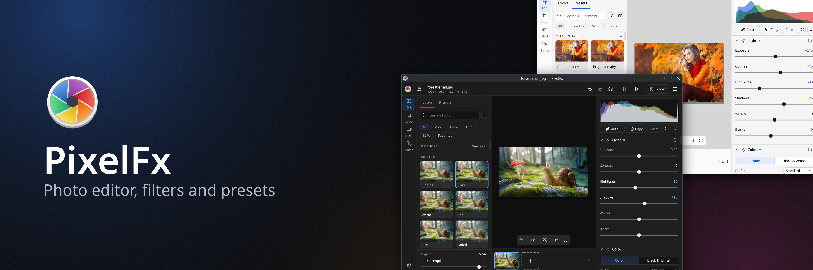
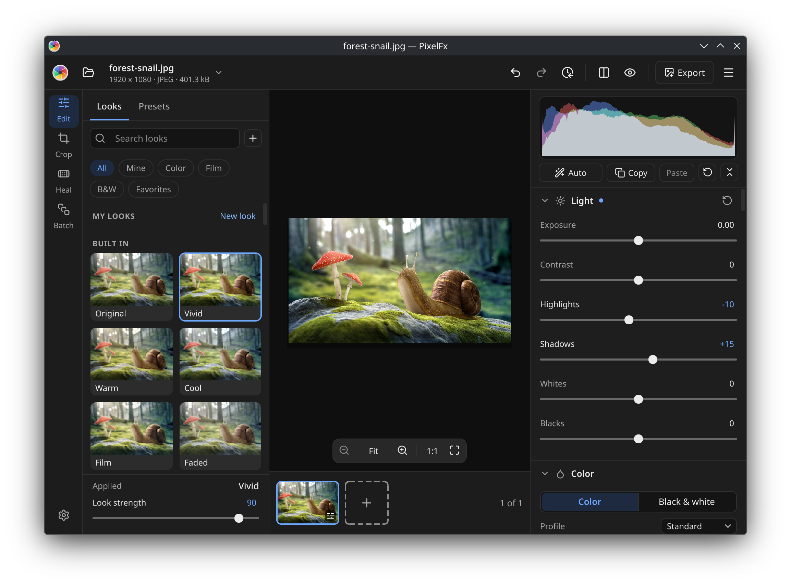
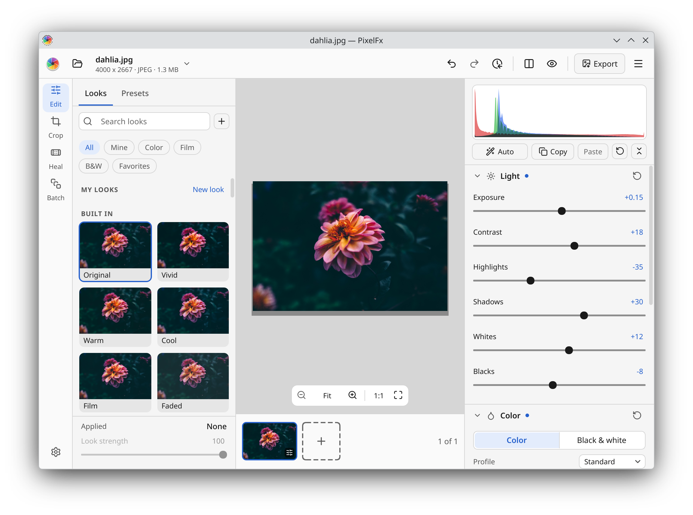
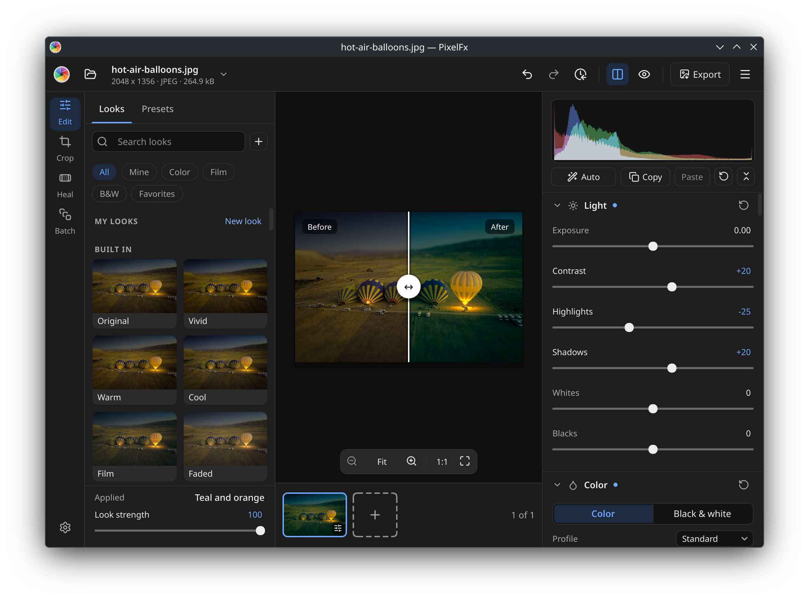
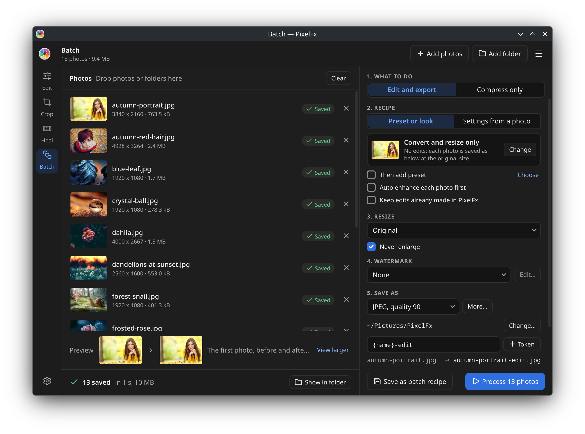
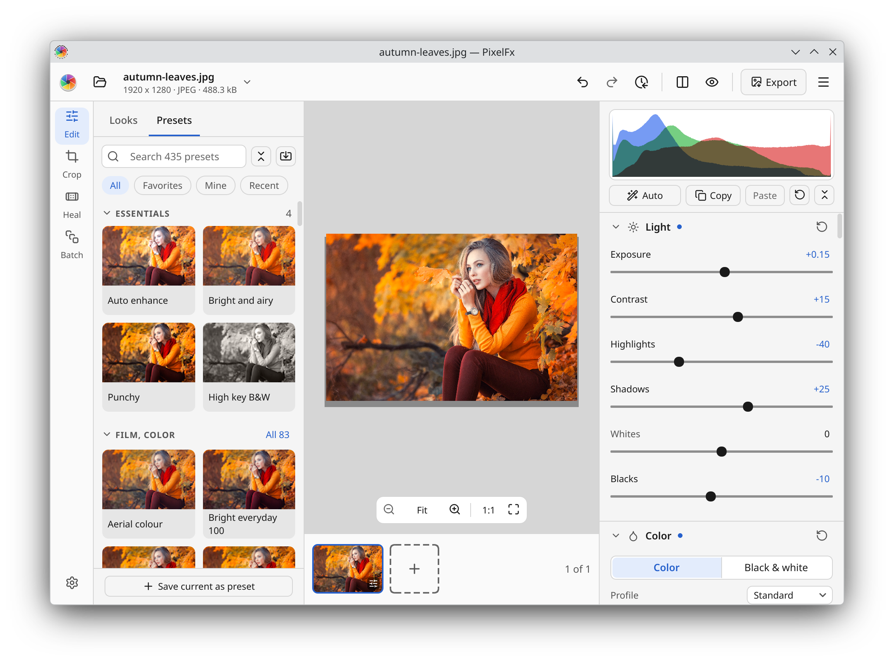

<p align="center">
  
</p>

<p align="center">
  <b>A fast, friendly photo editor for Linux.</b><br>
  Pick a look and see it on your own photo, fine-tune light and colour with the controls
  photographers expect, and finish a whole folder of photos in one go.
</p>

<p align="center">
  <a href="https://snapcraft.io/pixelfx"></a>
  <a href="https://apps.microsoft.com/detail/9P568SPSKG2C?mode=direct"></a>
  <a href="https://github.com/keshavbhatt/PixelFx/actions/workflows/ci.yml"></a>
  <a href="LICENSING.md"></a>
</p>

<p align="center">
  
</p>

## Why PixelFx

- **See it before you click.** Every look and preset previews on your own photo, live.
- **Hundreds of presets, and yours too.** More than 400 built in, plus your Lightroom and Camera
  Raw presets.
- **Many photos at once.** Batch edit, convert, resize, rename and shrink whole folders in the
  background.
- **Your originals are safe.** Edits are remembered for every photo; the original file is never
  changed.

## Features

**Looks, one click each**
- Built-in looks such as Vivid, Warm, Film, Golden hour, Teal and orange and Noir, each tile
  showing your photo, with a strength slider.
- Make your own looks from steps, or bring your `.cube` and HaldCLUT LUTs.

**Presets**
- More than 400 built-in presets in 12 categories: film, black and white, cinematic, portrait,
  landscape, seasons, places, vintage and more.
- Import Lightroom and Camera Raw presets (`.xmp`); save your own from the whole edit or parts of it.

**Every control you expect**
- Light, colour and white balance, curves, colour mixer, colour grading, detail (clarity,
  texture, sharpening, noise reduction, dehaze) and effects (vignette, grain, fade).
- One-click Auto, a live histogram with clipping warnings, and lens corrections from Lensfun.

**Crop, straighten and fix**
- Crop with common ratios, straighten with a dial or a drawn line, fix leaning buildings, and
  square a page or a wall from its four corners.
- Heal blemishes, dust and small objects with a spot or a brush.

**Batch and export**
- Stack presets and looks, resize, watermark, rename with tokens and choose the format for a whole
  folder; convert only, or make files smaller with a report of the space saved.
- Export to JPEG, PNG, TIFF, WebP, JPEG XL and more, with size presets for social media, the web
  and print.

**Opens what you shoot:** camera RAW, HEIC, AVIF, JPEG XL, JPEG, PNG, TIFF and WebP.

## Screenshots

<table>
  <tr>
    <td width="50%"><br><sub>Every light and colour control you expect, with a live histogram</sub></td>
    <td width="50%"><br><sub>Before and after on one photo, with a divider you can drag</sub></td>
  </tr>
  <tr>
    <td width="50%"><br><sub>Edit a whole folder of photos at once, in the background</sub></td>
    <td width="50%"><br><sub>Hundreds of presets, including your Lightroom and Camera Raw presets</sub></td>
  </tr>
</table>

## Install

<a href="https://snapcraft.io/pixelfx"></a>
<a href="https://apps.microsoft.com/detail/9P568SPSKG2C?mode=direct"></a>

On Linux:

```sh
sudo snap install pixelfx
```

On Windows 10 and 11, get it from the Microsoft Store. Flathub is on its way, and macOS will
follow.

## Build from source

```sh
scripts/dev-build.sh --tests
scripts/dev-run.sh -- photo.jpg
```

[`DOCS/BUILDING.md`](DOCS/BUILDING.md) has the requirements, Windows and macOS, the library on
its own, and the CMake options.

## For developers

- [`libs/pixelfx-core`](libs/pixelfx-core/README.md): **libpixelfx**, the image library behind
  PixelFx. C++20, no Qt, Apache-2.0, with its own `pfx` command line tool.
- [`DOCS/`](DOCS/README.md): the plan, feature list, design decisions, file formats, coding
  standards and progress log.
- [`DOCS/mocks/`](DOCS/mocks/): every screen as an HTML mock.

PixelFx 1 lives on the [`legacy-v1`](https://github.com/keshavbhatt/PixelFx/tree/legacy-v1) branch.

## Bugs and ideas

Open an [issue](https://github.com/keshavbhatt/PixelFx/issues). **Report a bug** in the app's
main menu or in About gathers the details that help find the problem.

## License

PixelFx is GPL-3.0-or-later and libpixelfx is Apache-2.0. See [`LICENSING.md`](LICENSING.md)
and [`THIRD_PARTY.md`](THIRD_PARTY.md).
